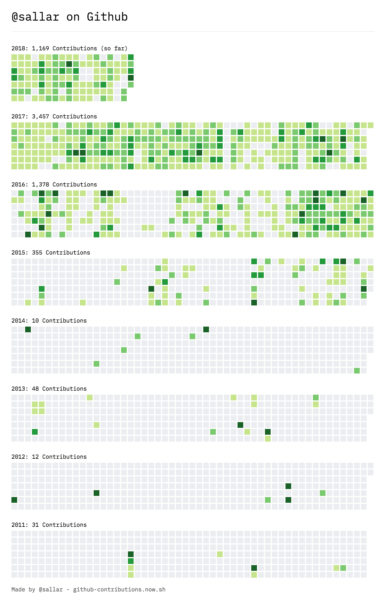

# :octocat: GitHub Contribution Chart Generator [](https://github.com/sallar/github-contributions-canvas/blob/master/LICENSE)

Generates an image of all your **GitHub** contributions since you have signed up, so you can use it in social media.

The API for this project lives in the `src/pages/api` directory since GitHub doesn't provide a way to access user statistics through it's official API.

The drawing mechanism lives in [the sallar/github-contributions-canvas repository](https://github.com/sallar/github-contributions-canvas).

## Requirements

- Node.js 24 (see `.nvmrc`) and Yarn 1.22.22.
- A valid github account.
- Open activity in setting (`Settings` > `Public profile` > `Contributions & Activity`).
  - [ ] Make profile private and hide activity

## Install

Enable Yarn with Corepack and install the locked dependencies:

```
$ corepack enable
$ yarn install --frozen-lockfile
```

## How to run

Running locally:

```
$ yarn dev
```

## Deployment

This project is deployed on [Vercel](https://vercel.com/). The Node.js runtime is
pinned to 24.x in `package.json`.

Build and run the production server locally:

```
$ yarn build
$ yarn start
```

## Tests

Browser checks cover responsive controls, keyboard theme selection, chart rendering,
PNG/JSON downloads, and missing profiles in Chromium and mobile WebKit, in light and dark mode.
Contribution responses are fixtures so the checks do not depend on GitHub availability.
API tests verify calendar date ranges and flat/nested JSON using HTML fixtures.

```
$ yarn playwright install --with-deps chromium webkit
$ yarn test:api
$ yarn build
$ yarn test
```

CI runs the same production build and browser checks on pull requests.

## Adding themes

Add your theme to [sallar/github-contribution-canvas](https://github.com/sallar/github-contributions-canvas) repo and also send a PR here to add the name of the theme to the list.

## Example

<div align="center">
  
</div>

## Contributing

Please read [CONTRIBUTING.md](./CONTRIBUTING.md) for details on our code of conduct, and the process for submitting pull requests to us.

## Changelog

Every release, along with the migration instructions, is documented on the GitHub [Releases](https://github.com/sallar/github-contributions-chart/releases) page.

## License

[MIT license](https://opensource.org/licenses/MIT)

[](https://vercel.com/?utm_source=github-contributions-chart&utm_campaign=oss)
